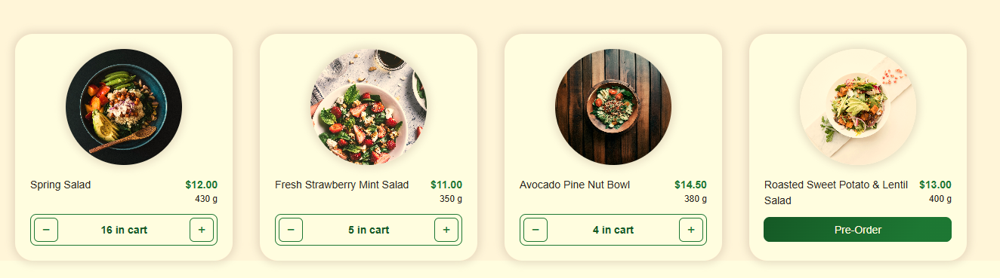
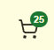
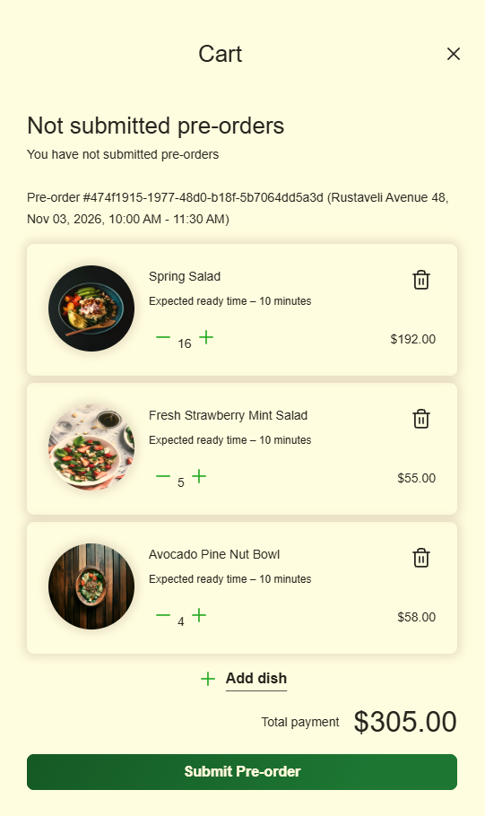

# EPAM IT Marathon 2026 — домашні завдання

| Папка | Завдання | Що зроблено |
|---|---|---|
| [`backend-hw5/`](backend-hw5) | Backend (.NET) #5: груповий pre-order, функціонал Owner | Рівні 1–3: `GET /guest/groups/{id}/sessions`, `GET /reservations/{id}/guest-session-id`, `POST /group-reservations/{id}/submit`, а також виправлений `DELETE …/sessions/{guestSessionId}` |
| [`frontend-hw6/`](frontend-hw6) | Frontend #6: екран Owner групового pre-order | Рівні 1–3 і бонус Remove Guest |

## Backend (`backend-hw5`)
- Код: `backend/restaurant-backend-app/dnapp/lambdas/api-handler` (Handlers, Services, Repositories, Routing).
- Маршрути зареєстровані в `Routing/RouteRegistry.cs` і в `deployment_resources.json`.
- Документація: `docs/ApiRoutes.md`, `swagger_src/swagger-ui/swagger-endpoints.yaml`, `CHANGELOG.md`.
- Тести: `cd backend/restaurant-backend-app/Tests && dotnet test` — 165 тестів (141 початкових і 24 нових).
- Наскрізна перевірка на розгорнутому API: `node backend/restaurant-backend-app/scripts/e2e-group-preorder.js <api-url>` — 37 перевірок, дані створюються і видаляються скриптом.

## Frontend (`frontend-hw6`)
- Код: `frontend/restaurant-frontend-app/src/app` — `pages/group-order-page`, `components/group-orders/participant-card`, `services/group-orders`.
- Запуск: `cd frontend/restaurant-frontend-app && npm ci && npm start`, далі `http://localhost:4200/reservations/demo-reservation/group-order?demo`.
- Тести домашки: `npm run test:hw` — 67 тестів, усі зелені. Також проходять `npx tsc -p tsconfig.app.json --noEmit`, `npx tsc -p tsconfig.spec.json --noEmit` і `BACKEND_URL=https://example.com npm run build`.

## Власна фіча: зрозумілий кошик і швидкий pre-order

Розгорнутий застосунок: https://d2t6f9kx6r7k4b.cloudfront.net

### Проблема
- Після кліку «Pre-Order» у меню видно лише тост «Dish added to cart successfully!». На картці страви й на іконці кошика нічого не змінюється, тому незрозуміло, скільки вже додано. Користувач клацає ще раз — і в замовленні опиняється 7 однакових салатів.
- Додавання страви тривало до 6–8 с: Lambda `api-handler` мала 128 МБ (холодний старт 6,7–7,6 с за логами CloudWatch), а фронтенд робив два запити підряд (`GET /orders` усіх замовлень + `PUT`).
- На екрані групового pre-order у картці «My Pre-Order» було «No dishes yet», хоча власні страви Owner уже лежать у замовленні й підуть у ресторан. Grand Total не збігався з тим, що реально отримає ресторан.
- Екран Owner відкривався лише за прямою адресою, а сторінка падала з «An unexpected error occurred» на справжньому API: інтерцептор не додавав токен до жодної адреси з `/guest/`, а ендпоінти Owner `/guest/groups/{id}/sessions` якраз під цим шляхом.

### Що зроблено
| Що | Де |
|---|---|
| Лічильник страв на іконці кошика з анімацією при додаванні (зважає на `prefers-reduced-motion`, має `aria-label` «Cart, 3 dishes») | `shared/custom-components/cart-button` |
| На картці страви після першого додавання замість «Pre-Order» — `− 2 in cart +` | `shared/custom-components/dish-card` |
| Спільний стор кошика на signals: зміна видно одразу, на сервер іде один запит; швидкі кліки не губляться (поки запит виконується, наступний чекає й відправляє останній стан); при помилці стан перечитується з сервера | `services/pre-orders/cart.store.ts` |
| Кнопка «Group Pre-Order» на картці бронювання (є в макеті) | `components/reservations/card-reservation` |
| Токен для `/guest/groups/…`; гостьові запити поважають `SKIP_ERROR_TOAST` (без тосту на кожну фонову синхронізацію) | `auth/token.interceptor.ts` |
| Owner бачить свої страви в «My Pre-Order»; при Submit зберігається знімок його замовлення, а в замовлення ресторану додаються лише кошики гостей | `GuestSessionService`, `GroupReservationService` (бекенд) |
| Lambda `api-handler`: 128 → 1024 МБ. Холодний старт 0,43 с, перший запит 0,74 с замість 6,7–7,6 с | `lambda_config.json` |

### Як це виглядає
| Меню: скільки вже в кошику, `−` / `+` | Лічильник на іконці кошика | Кошик (25 = 16 + 5 + 4) |
|---|---|---|
|  |  |  |

### Як перевірити
1. Увійти як Customer, забронювати столик, натиснути **Pre-order** на картці бронювання.
2. Додати страву: на картці з'явиться `− 1 in cart +`, на іконці кошика — лічильник.
3. На картці бронювання натиснути **Group Pre-Order**: у «My Pre-Order» видно власні страви, Grand Total їх враховує.

### Тести
- Frontend: `npm run test:hw` — 67/67; нові тести стору кошика (8), кнопки кошика (3), картки страви (3), кнопки Group Pre-Order (1), інтерцептора (3). Падіння `GeneralInformationComponent` / `RegisterComponent` (33) були в проєкті й до змін.
- Backend: `dotnet test` — 168 тестів (3 нові: страви Owner у відкритій і відправленій групі, знімок при Submit).

## AI
Робота виконана за допомогою AI-асистента (Claude Code). Результат перевірено юніт-тестами, e2e-скриптом на розгорнутому API, логами CloudWatch та запуском застосунку в браузері.
